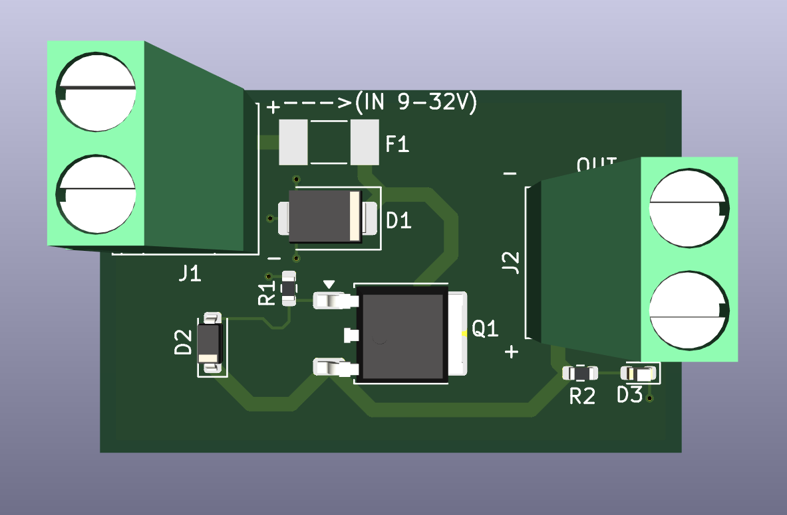
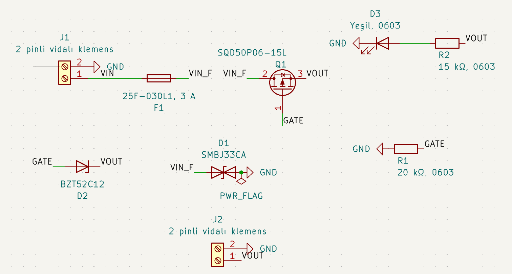
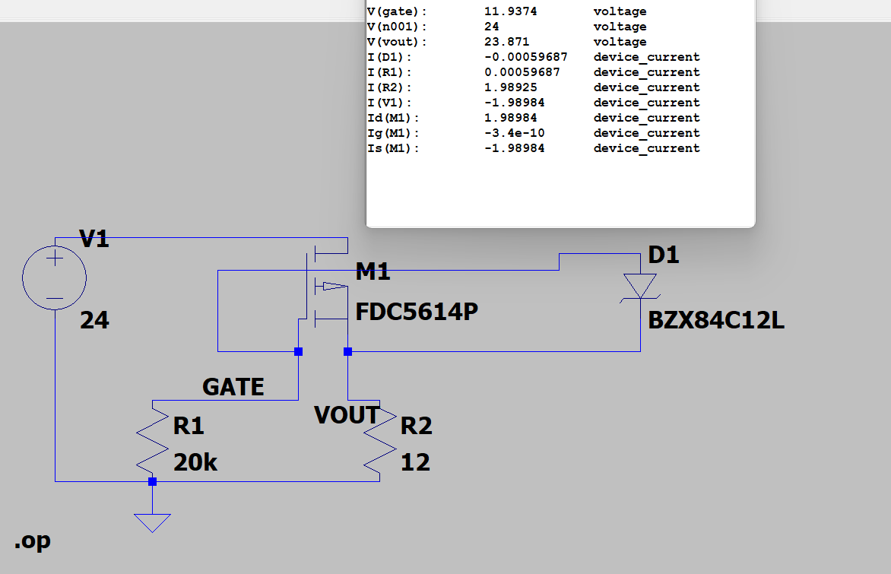
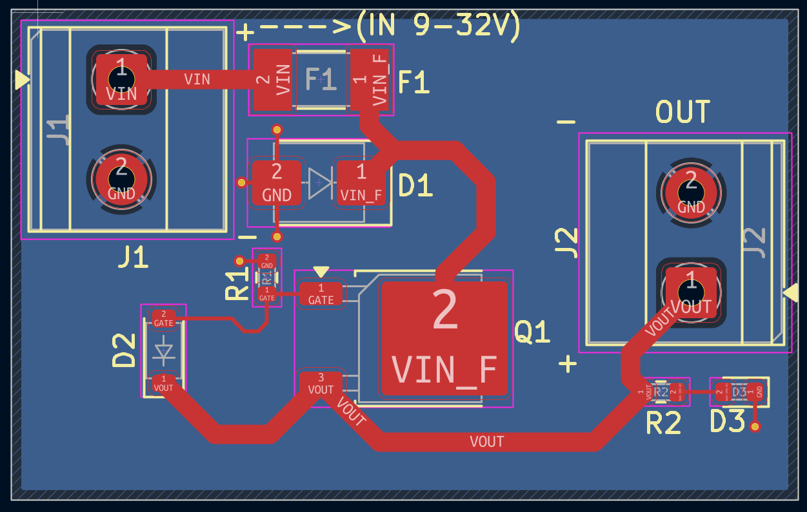

# E1 – Korumalı 12/24 V Güç Giriş Katı

Araç ve endüstri beslemeleri için koruma bloğu. Kartın geri kalanını **ters bağlantıya**, **gerilim darbelerine** ve **aşırı akıma** karşı korur.



## Özellikler

| Parametre | Değer |
|---|---|
| Giriş gerilimi | 9–32 V (12 V ve 24 V sistemler) |
| Ters bağlantı dayanımı | −32 V |
| Yük akımı | en fazla 2 A |
| Ters polarite koruması | P-MOSFET (diyotsuz, düşük kayıp) |
| Darbe koruması | Çift yönlü TVS (600 W) |
| Aşırı akım koruması | 3 A sigorta |
| Gösterge | Çıkışta yeşil LED |

## Blok diyagram

```
J1 (giriş) → F1 (sigorta) → D1 (TVS) → Q1 (P-MOSFET) → J2 (çıkış)
                                          │
                                  D2 (zener) + R1 (gate)
```

## Şema



## Malzeme listesi (BOM)

| Ref | Parça | Değer / Kılıf | Görev |
|---|---|---|---|
| F1 | HOLLY 25F-030L1 | 3 A, 125 V, hızlı | Aşırı akım |
| D1 | SMBJ33CA | Çift yönlü TVS, SMB | Gerilim darbesi |
| Q1 | Vishay SQD50P06-15L | P-MOSFET 60 V, TO-252 | Ters polarite |
| D2 | BZT52C12 | 12 V zener, SOD-123 | Vgs sınırlama |
| R1 | Direnç | 20 kΩ, 0603 | Gate direnci |
| R2 | Direnç | 15 kΩ, 0603 | LED akımı |
| D3 | LED | Yeşil, 0603 | Durum göstergesi |
| J1, J2 | Vidalı klemens | 2 pin, 5,08 mm | Giriş / çıkış |

## Hesaplar

### 1. Ters polarite: neden MOSFET, neden diyot değil?

| Çözüm | Kayıp (2 A) |
|---|---|
| Seri diyot (Vf ≈ 0,7 V) | 0,7 V × 2 A = **1,4 W** |
| P-MOSFET (Rds(on) = 15 mΩ) | 2² × 0,015 = **0,06 W** |
| P-MOSFET, sıcakta (125 °C, 25 mΩ) | 2² × 0,025 = **0,10 W** |

MOSFET ile kayıp yaklaşık **23 kat daha az.**

### 2. Gate koruması (zener + direnç)

- 32 V girişte zener olmasaydı Vgs = −32 V olurdu → MOSFET'in sınırı ±20 V, **MOSFET bozulurdu.**
- 12 V zener, Vgs'yi −12 V'ta sabitler.
- R1 = (32 V − 12 V) ÷ 1 mA = **20 kΩ**
- R1'in gücü = 20 V × 1 mA = **0,02 W** (0603 sınırı 0,1 W → 5 kat pay ✓)
- 9 V girişte zener iletmez, Vgs = −9 V → MOSFET tam açık (Rds(on) −4,5 V'ta bile tanımlı ✓)

### 3. Isınma

- RthJA = 50 °C/W (sürekli çalışma, 1 inç² bakır)
- Sıcaklık artışı = 0,10 W × 50 °C/W = **~5 °C**

### 4. TVS seçimi

| Değer | SMBJ33CA | Neden? |
|---|---|---|
| Vrwm | 33 V | En yüksek çalışma gerilimi (32 V) bunun altında olmalı |
| Vbr (min) | 36,7 V | İletime geçmeye başladığı gerilim |
| Vc (max) | 53,3 V | Darbede kırptığı en yüksek gerilim (Ipp = 11,3 A) |

**Tasarım sırasında bulunan iki hata ve çözümleri:**

1. **Tek yönlü TVS ters polariteyi bozuyordu.** SMBJ33A (tek yönlü), ters bağlantıda normal bir diyot gibi iletip kısa devre oluşturur. → **Çift yönlü SMBJ33CA** seçildi.
2. **40 V'luk MOSFET yetersizdi.** Ters bağlantıdayken gelen bir darbe, MOSFET'in üstünde 53 V'a kadar gerilim oluşturur. İlk aday AOD4185 (40 V) bunu taşıyamaz. → **60 V'luk SQD50P06-15L** seçildi.

### 5. Sigorta

- Akım: 2 A ÷ 0,75 ≈ 2,7 A → **3 A**
- Gerilim: ≥ 63 V gerekli (yüksek akımlı polyfuse'lar genelde 15–24 V olduğu için klasik sigorta seçildi) → **125 V**
- Hızlı tip seçildi: kartın giriş kapasitansı küçük, açılış akımı (inrush) sigortayı attırmaz. Girişe büyük bir kondansatör eklenirse **gecikmeli (slow-blow)** tipe geçilmeli.

### 6. LED

- R2 = (32 V − 2 V) ÷ 2 mA = **15 kΩ**, güç = 0,06 W ✓
- 9 V'ta ~0,5 mA → LED sönük ama yanar

## Simülasyon (LTspice)

`.op` analizi, yük = 12 Ω (24 V'ta 2 A). Simülasyonda kütüphanede bulunan **FDC5614P** (60 V P-MOSFET) ve **BZX84C12L** (12 V zener) modelleri kullanıldı.

| Test | VOUT | Vgs | Zener akımı | Sonuç |
|---|---|---|---|---|
| +24 V | 23,87 V | −11,93 V | 0,60 mA | ✓ Akım geçiyor |
| +32 V | 31,83 V | −12,00 V | 0,99 mA (el hesabı: 1 mA) | ✓ Zener Vgs'yi sınırlıyor |
| −24 V (ters) | ~0 V | ~0 V | ~0 | ✓ Yük korunuyor |



## PCB



- 2 katman; güç izleri 1,0 mm, sinyal izleri 0,25 mm
- Arka yüzde GND dolgusu; TVS'in GND pad'inde 3 via (darbe akımının dönüş yolu)
- TVS, giriş klemensine yakın yerleştirildi
- Giriş ve çıkışta polarite etiketleri (+ / −)
- ERC: 0 hata · DRC: 0 hata

## Bilinen sınırlamalar

- Darbe anında çıkış (VOUT) birkaç mikrosaniye boyunca **~53 V'a** kadar çıkabilir. Arkaya bağlanacak regülatör en az **60 V** girişe dayanıklı olmalı.
- Simülasyonda gerçek parça yerine benzer modeller kullanıldı; MOSFET üstündeki düşüm gerçek kartta daha az olur (15 mΩ'a karşı ~65 mΩ).

## Dosyalar

- `e1-guc-giris.kicad_sch`: Şema
- `e1-guc-giris.kicad_pcb`: PCB
- `e1-sim.asc`: LTspice simülasyonu
- `images/`: README görselleri
